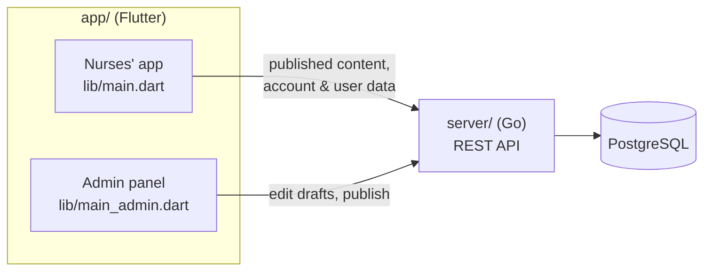

# AvA – Nursing Assistant

[](https://github.com/mmdshin/ava/actions/workflows/ci.yml)
[](LICENSE)

**آوا – دستیار آموزشی و بالینی پرستاری**

AvA is a Persian educational and clinical assistant for nurses and
nursing students. It brings nursing care plans (NANDA-I diagnoses with
related factors, defining characteristics, interventions and outcomes),
a Gordon-assessment diagnosis finder and self-assessment quizzes into
one app that works on the web, Android and iOS, including offline.

Developed at Mashhad University of Medical Sciences as part of a
research project.

> **Not a substitute for clinical judgment.** AvA is an educational and
> decision-support tool. Suggested care plans must be reviewed for each
> patient; responsibility for care decisions stays with the care team.

## Features

**For nurses (the app)**
- Care plans by disease category, with search, favorites and personal notes
- Diagnosis finder: pick a disease, tick assessment findings across Gordon's functional health patterns, get matching care plans
- Quizzes in practice mode (instant feedback) or exam mode, with results, answer review and "practice my mistakes"
- Accounts: favorites, notes and quiz progress follow you across devices
- Installable web app that works offline; light and dark themes; accessible (screen readers, large text, contrast)

**For the content team (the admin panel)**
- Edit disease categories (name, short code, card color, icon), care plans, quizzes, the Gordon assessment and tags
- Drafts, validation and publishing in versions; nurses only see published content
- Roles (editor, reviewer, admin), a full change history and a publishing freeze for clinical trials

## How it fits together



- **[`app/`](app)**: Flutter (Riverpod, go_router). One project, two entry points: the nurses' app and the admin panel.
- **[`server/`](server)**: Go standard library + PostgreSQL. Content is stored in normalized tables, validated and published as immutable, numbered versions; the app downloads a version once and caches it.

## Quick start (Docker)

Requires Docker with Compose.

```sh
git clone https://github.com/mmdshin/ava.git
cd ava
cp .env.example .env

docker compose up -d --build     # database, API, app, admin panel
docker compose run --rm seed     # once: load and publish the made-up sample content
```

| | |
|---|---|
| App | http://localhost:8000 |
| Admin panel | http://localhost:8001 |
| API | http://localhost:8080 (e.g. `/v1/content/manifest`) |

There are no default accounts. Sign up in the app, or create an admin
for the admin panel:

```sh
docker compose run --rm api create-user --email you@example.com --name "Your name" --role admin
# asks for a password (at least 8 characters)
```

The first build downloads the Go and Flutter toolchains and takes a
while. If `proxy.golang.org` is blocked on your network, set `GOPROXY`
in `.env` (e.g. `https://goproxy.io,direct`). A `Makefile` has
shortcuts: `make up`, `make sample`, `make admin EMAIL=… NAME=…`.

## Development

Run the database and API in Docker and Flutter on your machine:

```sh
docker compose up -d --build db api
docker compose run --rm seed

cd app
flutter pub get
flutter run -d chrome --web-port 8000                            # app
flutter run -d chrome -t lib/main_admin.dart --web-port 8001     # admin panel
```

Details: [app/README.md](app/README.md) · [server/README.md](server/README.md) (commands, API, content rules).

### Tests

```sh
cd server && go test ./...          # add AVA_TEST_DATABASE_URL for the database tests
cd app && flutter analyze && flutter test
```

CI runs both on every push ([`.github/workflows/ci.yml`](.github/workflows/ci.yml)).

## Content is private

The real educational content is **not** in this repository; only
made-up samples (`server/testdata/sample_bundle.json`,
`app/test/fixtures/sample_bundle.json`). Keep your content in a private
folder outside the repository and import it into the server:

```sh
# .env: AVA_CONTENT_DIR=/path/to/private/content
docker compose run --rm api import --dir /content
docker compose run --rm api publish --notes "first version"
```

After that, edit and publish it from the admin panel.

## Deploying

- Put the API and both web apps behind HTTPS.
- Build the web app with your API address: `AVA_API_URL=https://api.example.com` in `.env`, then `docker compose build web`.
- Set `CORS_ORIGINS` to your real web addresses only, use a strong `POSTGRES_PASSWORD`, and consider `ALLOW_SIGNUP=false`.
- Serve the web files with `Cache-Control: no-cache` (already done by [`app/docker/nginx.conf`](app/docker/nginx.conf)).
- Back up the `pgdata` volume.

## Project layout

```
app/                    Flutter: nurses' app + admin panel
  lib/                  source (lib/admin/ = admin panel)
  test/                 tests, with an in-memory fake server
  web/                  PWA manifest and offline service worker
  Dockerfile            builds both web versions, served by nginx
server/                 Go API + PostgreSQL
  cmd/ava-server/       CLI: migrate, import, validate, publish, create-user, serve, …
  internal/             content model and rules, store (SQL), auth, HTTP API
  testdata/             made-up sample content
docker-compose.yml      the whole stack for local use
.github/workflows/      CI
```

## License

[MIT](LICENSE).

Third-party assets keep their own licenses:
- [Vazirmatn](https://github.com/rastikerdar/vazirmatn) font: SIL Open Font License 1.1 (`app/assets/fonts/OFL.txt`).
- The Mashhad University of Medical Sciences logo (`app/assets/images/mums_logo.png`) belongs to the university and is not covered by the MIT license.
